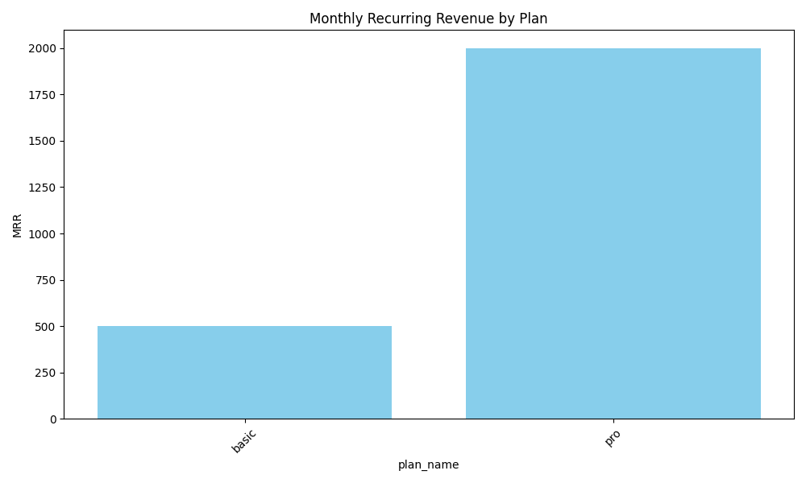

# SaaS Subscription Analytics

## Overview
An analytics project for a simulated SaaS subscription business using PostgreSQL and Python. It demonstrates how subscription lifecycle data can be queried and translated into recurring-revenue and customer-status metrics.

## Business questions
- How many users currently have an active subscription?
- What share of distinct users have ended all subscriptions?
- What is the current monthly recurring revenue (MRR)?
- How is MRR distributed across subscription plans?

## Metrics and definitions
- **Active users:** distinct users with at least one subscription whose `end_date` is `NULL`.
- **Former-customer share:** distinct users with an ended subscription and no currently active subscription, divided by all distinct users in the subscriptions table. This is a point-in-time customer-status measure, **not** a conventional period-based churn rate.
- **MRR:** sum of listed monthly plan prices for currently active subscriptions. This assumes each active subscription contributes the plan's full monthly price; discounts, refunds, billing cadence, and payment status are not modeled.

## Tech stack
- PostgreSQL
- SQL: joins, CTEs, aggregation, `NOT EXISTS`
- Python: `psycopg2`, `pandas`, `matplotlib`, `python-dotenv`

## Setup
1. Create/activate a Python environment.
2. Install dependencies: `pip install -r requirements.txt`.
3. Create a local `.env` file by copying `.env.example`, then enter your own PostgreSQL connection values.
4. Ensure the database `DB_NAME` contains the `subscriptions` and `plans` tables with the columns used in the script.
5. Run: `python churn_rate_with_SQL.py`.

Never commit your real `.env` file or database credentials. The script reads connection settings from environment variables.

## Output
The script prints active users, former-customer share, MRR, and MRR by plan, then plots MRR by plan.

## Sample visualization

## Scope and limitations
This is a simulated/practice analytics project, not a production billing system. The dataset does not include payment events or a defined observation window, so it cannot establish revenue actually collected or a time-windowed churn rate. Query results depend on the local database contents and have not been published here as fixed business findings.
